<div align="center">
  
  <h1>Notey</h1>

  <p><strong>A fluid, edge-docked sticky notes application for macOS.</strong></p>

  <p>
    <a href="#features">Features</a>
    ·
    <a href="#install">Install</a>
    ·
    <a href="#keyboard-shortcuts">Shortcuts</a>
    ·
    <a href="#build-from-source">Build from Source</a>
    ·
    <a href="#tech-stack">Tech Stack</a>
    ·
    <a href="#privacy">Privacy</a>
  </p>

  <p>
    
    
    
    
    
    
  </p>
</div>

---

**Notey** is a minimal, native macOS edge-docked sticky notes utility built with Swift, SwiftUI, and AppKit. Designed to live subtly on the edge of your desktop, Notey provides instant access to quick notes, scratchpads, and interactive checklists without disrupting your focus or cluttering your workspace.

No accounts. No telemetry. No background bloat. Just fluid, native sticky notes.

---

## Features

### Edge-Docked Architecture
- **Discreet Idle Capsule Dock**: Compact 6px pill tabs sit subtly along the screen bezel, staying out of sight during deep focus.
- **Proximity-Aware Fan Deck**: Moving your cursor near the edge smoothly fans out tabs into an overlapping card stack with staggered cascade physics.
- **Single-Note Expansion & Dwell**: Hovering over any individual tab expands the card for instant reading and editing while collapsing others.
- **Fluid Spring Mechanics**: Custom spring-damped easing curves deliver authentic tactile feedback on expansion, fanning, and collapse.

### Tactile Card Deck & Aesthetics
- **Handwriting Typography**: Notes render in `Chalkboard SE` and bundled `Caveat` for an authentic sticky-note appearance.
- **Curated Color Palettes**: Visual presets in Yellow, Coral, Mint, Blue, and Lavender tones.
- **Custom Color Picker & Eyedropper**: Pick any custom shade or sample colors from your display using native macOS color panels.
- **Layered Paper Depth**: Realistic card drop shadows, perforated tab handles, and subtle paper fold styling.

### Focused Writing & Interactive Checklists
- **Markdown Scratchpad**: Multi-line plain text editing with full word wrapping, undo/redo, and native AppKit first-responder integration.
- **Procedural Scribble Checklists**: Interactive checkboxes featuring animated pen-drawn checks and organic strikethroughs powered by de Casteljau cubic bezier splines and FNV-1a seeded randomization.
- **Rapid Keyboard Controls**: Press `Enter` to create subsequent checklist items, `Backspace` on empty items to remove or merge, and arrow keys to navigate.
- **First-Launch Guide Seeding**: Friendly starter guide notes populate on first launch to teach gestures and interactions.

### Native macOS Integration
- **True Desktop Floating Panels**: Powered by non-activating `NSPanel` instances at `.statusBar` level—floating above windows without stealing system keyboard focus.
- **Menu Bar Status Item**: Create notes, summon the deck, view archives, and check for updates from the macOS menu bar.
- **Global Hotkeys**: Instant keyboard shortcut (`Cmd + Option + L`) to toggle your archive from anywhere in macOS.
- **Automatic Updates**: Integrated Sparkle 2 updater with Ed25519 signature verification for seamless background updates.
- **Local Atomic JSON Store**: Changes persist immediately to disk via atomic file writes with zero network requests or telemetry.

---

## Keyboard Shortcuts

| Shortcut | Action |
|---|---|
| `Cmd + N` | Create New Note |
| `Cmd + D` | Open / Summon Note Deck |
| `Cmd + Option + L` | Global Hotkey: Toggle Archive Panel |
| `Enter` | Create Next Checklist Item (in checklist mode) |
| `Backspace` | Merge / Remove Empty Checklist Item |
| `Esc` | Close Note Editor / Dismiss Panel |
| `Cmd + Z` / `Cmd + Shift + Z` | Undo / Redo Text Editing |

---

## Install

### Download Pre-Built DMG

1. Download the latest `.dmg` release from the [Releases](https://github.com/drunkardleo-10/notey/releases) page.
2. Open the downloaded disk image and drag **Notey** into your `/Applications` directory.
3. Launch **Notey** from Applications or Spotlight.

> [!NOTE]
> As Notey is ad-hoc signed, macOS Gatekeeper may prompt you on initial launch. Right-click the application in `/Applications` and select **Open**, or run the following command in Terminal:
> ```sh
> xattr -cr /Applications/Notey.app
> ```

### Requirements
- **macOS Sonoma (14.0)** or later
- Apple Silicon (M1/M2/M3/M4) or Intel Mac

---

## Build from Source

### Prerequisites
- macOS 14.0+
- Xcode 15.0+ / Swift 5.9+ (Swift 6 ready)
- [XcodeGen](https://github.com/yonaskolb/XcodeGen) (`brew install xcodegen`)

### 1. Clone the repository
```bash
git clone https://github.com/drunkardleo-10/notey.git
cd notey
```

### 2. Build & Test via Swift Package Manager
```bash
swift build
swift test
```

### 3. Generate Xcode Project
```bash
xcodegen generate
open Notey.xcodeproj
```
Press `Cmd + R` in Xcode to build and run the application.

### 4. Package Release DMG
```bash
./scripts/make-dmg.sh
```
The resulting `Notey-<version>.dmg` will be created in the `dist/` directory.

---

## Tech Stack

| Component | Technology |
|---|---|
| **Language & Concurrency** | Swift 6.0 (Strict Concurrency ready) |
| **UI Framework** | SwiftUI + AppKit (`NSPanel`, `NSTextView`, `NSTrackingArea`, `NSHostingView`) |
| **Window Level & Mechanics** | Non-activating borderless `NSPanel` at `.statusBar` level |
| **Checklist Animations** | Procedural pen strikes, de Casteljau cubic bezier splines, FNV-1a random seeding |
| **Typography & Fonts** | Custom `Caveat` font, Apple `Chalkboard SE`, dynamic paper grain |
| **Color Engine** | Hex color utilities, preset pastel palettes, `NSColorPanel` & `NSColorSampler` eyedropper |
| **Global Shortcuts** | Carbon Events API (`RegisterEventHotKey`) |
| **Automatic Updates** | Sparkle 2 (`SPUStandardUpdaterController`, Ed25519 signatures) |
| **Data Storage** | Local atomic JSON storage (`FileManager` + `JSONEncoder`/`JSONDecoder`) |
| **Project & Packaging** | XcodeGen (`project.yml`), `make-dmg.sh`, GitHub Actions Release CI |

---

## Privacy

All data and processing in Notey occurs strictly on-device:
- **Zero Telemetry**: No tracking, metrics, analytics, or external phone-home network calls.
- **Local Storage**: Notes, archives, and preferences are stored locally in atomic JSON files.
- **No Accounts**: No sign-ins, accounts, or cloud subscriptions required.

---

## Contributing

Contributions, bug reports, and suggestions are welcome!
1. Fork the repository
2. Create your feature branch (`git checkout -b feature/amazing-feature`)
3. Test your changes thoroughly (`swift test`)
4. Commit your changes (`git commit -m 'Add amazing feature'`)
5. Push to the branch (`git push origin feature/amazing-feature`)
6. Open a Pull Request

---

## License

This project is licensed under the MIT License — see the [LICENSE](LICENSE) file for details.
